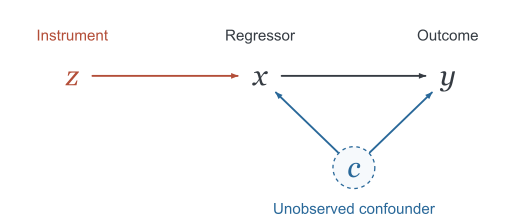

## Abstract

Streaming sieve generalized method of moments (SSGMM) estimates a nonlinear IV model from one ordinary observation at a time, without a conditional two-sample oracle or a fitted first-stage nuisance model. It combines directly evaluated Hermite moments with a running Jacobian, so its statistical behavior depends on both the selected basis and the update dynamics. We give a basis-dependent condition for regular local identification and, under explicit local smoothness and moment assumptions, an $O(T^{-1})$ mean-square convergence bound. Experiments then separate missing identification, weak signal, and initialization effects, showing how these conditions appear in finite samples.

**Contents**

- [Abstract](#abstract)
- [Problem setting and introduction](#problem-setting-and-introduction)
- [Preliminaries: Hermite moments and the streaming update](#preliminaries-hermite-moments-and-the-streaming-update)
  - [Hermite basis](#hermite-basis)
  - [Moments and streaming update](#moments-and-streaming-update)
- [Main results](#main-results)
  - [Identification](#identification)
  - [Convergence](#convergence)
- [Experiments](#experiments)
  - [Identification and the convergence threshold](#identification-and-the-convergence-threshold)
  - [Basis expansion: signal and noise](#basis-expansion-signal-and-noise)
  - [Nonlinear parameters and initialization](#nonlinear-parameters-and-initialization)
- [References](#references)

## Problem setting and introduction

We observe an i.i.d. stream $D_t=(z_t,x_t,y_t)$ generated by

$$
y=g(\theta_*;x)+\varepsilon,
\qquad \theta_*\in\mathbb R^d,
\qquad \mathbb E[\varepsilon\mid z]=0.
$$

*An illustrative IV DAG. The unobserved confounder $c$ affects both $x$ and $y$, while $z$ is independent of $c$ and affects $y$ only through $x$.*

Here $g$ may be nonlinear in both $x$ and $\theta$. Because $\mathbb E[\varepsilon\mid x]$ may be nonzero, minimizing prediction error need not recover the structural parameter. Instrument validity instead supplies a family of orthogonality conditions: for square-integrable residuals,

$$
\begin{aligned}
&\mathbb E[g(\theta;x)-y\mid z]=0\\
&\quad\Longleftrightarrow\quad
\mathbb E\!\left[f(z)\{g(\theta;x)-y\}\right]=0
\quad\text{for every }f\in L^2(P_z).
\end{aligned}
$$

Thus choosing a finite vector $f$ gives GMM moments [Hansen (1982)][hansen]. However, some useful choices involve unknown conditional expectations. For example, conditional stochastic optimization uses

$$
\begin{aligned}
L(\theta)&=\frac12\mathbb E\!\left[
  \bigl(\mathbb E[g(\theta;x)-y\mid z]\bigr)^2\right],\\
\nabla L(\theta)&=\mathbb E\!\left[
  \mathbb E[\nabla_\theta g(\theta;x)\mid z]\,
  \mathbb E[g(\theta;x)-y\mid z]\right],
\end{aligned}
$$

where differentiation is assumed to pass through expectation. To estimate this product without bias, TOSG-IVaR uses an additional $x^\prime$ drawn from the true conditional distribution, independently of $(x,y)$ given the same $z$. This is a **conditional two-sample oracle**; the one-sample OTSG-IVaR formulation instead estimates first-stage coefficients in a linear model [Chen et al. (2024)][streaming-iv].

Our aim is therefore to retain the directly evaluable moment condition while making its optimization fully streaming:

> **One observed tuple per update (streaming), no conditional two-sample oracle, and no first-stage or conditional-model nuisance estimation.**

The comparison below focuses on 2SLS and the streaming methods relevant to this goal.

| Method | Nonlinear IV | Two-sample oracle | Nuisance Estimation |
|:--|:--|:--|:--|
| [2SLS][kiv] | No | No | Yes |
| [TOSG-IVaR][streaming-iv] | Yes | Yes | No |
| [OTSG-IVaR][streaming-iv] | No | No | Yes |
| [SGMM][sgmm] | No | No | No |
| SSGMM | Yes | No | No |

## Preliminaries: Hermite moments and the streaming update

### Hermite basis

To construct $f$ directly, suppose $z\sim N(0,I_{d_z})$. The normalized tensor Hermite functions are

$$
\psi_\nu(z)=\prod_{j=1}^{d_z}
\frac{\operatorname{He}_{\nu_j}(z_j)}{\sqrt{\nu_j!}},
\qquad \nu\in\mathbb N_0^{d_z},
$$

and they form an orthonormal system in $L^2(P_z)$. Consequently, their coordinates give comparable scales for different instrument moments. The first total-degree blocks are

$$
\psi_0(z)=1,\qquad \psi_1(z)=z,\qquad
\psi_2(z)=\left(
\frac{z_j^2-1}{\sqrt2},\ z_jz_\ell:\ j<\ell
\right)^\top.
$$

We stack all terms whose total degrees belong to a fixed set $\mathcal K$, obtaining $\psi_{\mathcal K}\in\mathbb R^{p_{\mathcal K}}$, where

$$
p_{\mathcal K}=\sum_{k\in\mathcal K}\binom{d_z+k-1}{k}.
$$

For eight instruments, the sets H1, H01, H012, and H0123 denote degrees $\lbrace1\rbrace$, $\lbrace0,1\rbrace$, $\lbrace0,1,2\rbrace$, and $\lbrace0,1,2,3\rbrace$, giving 8, 9, 45, and 165 moments. Although orthonormality normalizes the features, it does not make the moment-noise covariance the identity; identity-weighted GMM therefore need not be statistically efficient.

### Moments and streaming update

With this basis, define

$$
\begin{aligned}
m(D,\theta)&=\psi_{\mathcal K}(z)\{g(\theta;x)-y\},\\
M(D,\theta)&=\psi_{\mathcal K}(z)\nabla_\theta g(\theta;x)^\top,\\
\bar m(\theta)&=\mathbb E[m(D,\theta)],\qquad
\bar M(\theta)=\mathbb E[M(D,\theta)].
\end{aligned}
$$

Instrument validity gives $\bar m(\theta_{\ast})=0$, so we target $Q(\theta)=\lVert\bar m(\theta)\rVert^2/2$. This squares the expected moment; minimizing $\mathbb E\lVert m(D,\theta)\rVert^2/2$ would generally target a different parameter under endogeneity.

Following the nonlinear SGMM construction [Chen et al. (2025)][sgmm], we use a damped gain

$$
A_\lambda(S)=(S^\top S+\lambda I_d)^{-1}S^\top,
\qquad \lambda>0,
$$

and, after observing $D_{t+1}$, update

$$
\begin{aligned}
\theta_{t+1}
 &=\Pi_\Theta\!\left[
 \theta_t-\alpha_{t+1}A_\lambda(S_t)m(D_{t+1},\theta_t)\right],\\
S_{t+1}
 &=(1-\beta_{t+1})S_t+\beta_{t+1}M(D_{t+1},\theta_t),\\
\bar\theta_T&=\frac1T\sum_{t=1}^T\theta_t.
\end{aligned}
$$

Here $\Pi_\Theta$ is Euclidean projection.
Crucially, the parameter step uses the **previous Jacobian state** $S_t$, so, with $\mathcal F_t=\sigma(D_1,\ldots,D_t)$,

$$
\mathbb E\!\left[
A_\lambda(S_t)m(D_{t+1},\theta_t)\mid\mathcal F_t\right]
=A_\lambda(S_t)\bar m(\theta_t).
$$

Thus the same observation can update both states, even when their sample noises are correlated. Meanwhile, $S_t$ tracks a finite unconditional Jacobian, so no conditional nuisance function is fitted. Taking $\alpha_t/\beta_t\to0$ lets that state adapt faster than the parameter [Borkar (1997)][borkar], while averaging gives the second estimator above [Polyak and Juditsky (1992)][polyak]. For fixed dimensions, the required memory is independent of the stream length.

## Main results

### Identification

We denote

$$
G_{\mathcal K}=\bar M(\theta_*),\qquad
\mu_{\mathcal K}=\lambda_{\min}(G_{\mathcal K}^\top G_{\mathcal K}).
$$

We have the following result regarding the local identification condition.

**Result 1 — first-order local identification.** The selected moments identify $\theta_{\ast}$ to first order if and only if $G_{\mathcal K}$ has full column rank, equivalently $\mu_{\mathcal K}>0$. Assume $D_\theta\bar m=\bar M$ and that $\bar M$ is $L$-Lipschitz in Frobenius norm near $\theta_{\ast}$. Under this rank condition, local identification follows from the bound

$$
\|\bar m(\theta_*+e)\|
\ge\sqrt{\mu_{\mathcal K}}\|e\|-\frac L2\|e\|^2
$$

whenever the connecting segment stays in that neighborhood. Here first-order identification means that every nonzero parameter direction $v$ changes at least one selected moment in the linearization: $G_{\mathcal K}v\ne0$.

**Proof.** First-order identification requires that $G_{\mathcal K}v=0$ imply $v=0$, which is equivalent to full column rank. To obtain the local bound, use $\bar m(\theta_{\ast})=0$ and the integral Taylor formula:

$$
\begin{aligned}
\bar m(\theta_*+e)&=G_{\mathcal K}e+R(e),\\
R(e)&=\int_0^1
 \{\bar M(\theta_*+se)-G_{\mathcal K}\}e\,ds.
\end{aligned}
$$

The Lipschitz assumption therefore yields $\lVert R(e)\rVert\le L\lVert e\rVert^2/2$. Meanwhile, full column rank gives $\lVert G_{\mathcal K}e\rVert\ge\sqrt{\mu_{\mathcal K}}\lVert e\rVert$, so the reverse triangle inequality proves the stated bound. Its right-hand side is positive for all sufficiently small nonzero $e$: when $L>0$, it suffices that $\lVert e\rVert<2\sqrt{\mu_{\mathcal K}}/L$, while for $L=0$ the remainder vanishes. Consequently, the moment map has no other zero in a sufficiently small neighborhood. $\square$

Full column rank requires $p_{\mathcal K}\ge d$, but the number of moments alone is insufficient. Rank deficiency rules out first-order identification, although higher-order terms can still identify the parameter locally. Global identification further requires that $\bar m$ have no other zero on the parameter set. Adding basis blocks can increase $\mu_{\mathcal K}$, although their additional sampling noise can still worsen finite-sample estimation.

### Convergence

Identification determines the target, whereas convergence also requires the recursion to remain in a contracting region. Fix an identifying basis and a deterministic compact convex set $\Theta$ containing both $\theta_{\ast}$ and $\theta_0$, with finite deterministic $S_0$. Assume that $D_\theta\bar m=\bar M$ is $L$-Lipschitz on $\Theta$, and that $m(D,\theta)$ and $M(D,\theta)-\bar M(\theta)$ have uniformly bounded fourth moments there.

To state a sufficient local condition, abbreviate $G=G_{\mathcal K}$, $\mu=\mu_{\mathcal K}$, and set

$$
\begin{aligned}
h&=\frac{\mu}{\mu+\lambda},\qquad
\ell_\lambda=\frac5{4\lambda},\\
c&=L\!\left(\ell_\lambda\|G\|_{\mathrm{op}}
                +\frac1{4\sqrt\lambda}\right).
\end{aligned}
$$

Require $\Theta\subseteq B(\theta_{\ast},r)$ with $rc\le h/4$. This condition controls curvature relative to identification strength; it does not supply a way to locate the unknown truth.

**Result 2 — local mean-square convergence.** Choose

$$
\alpha_t=\frac a{t+t_0},\qquad
\beta_t=\frac b{(t+t_0)^{2/3}},\qquad ah>1,
$$

with $a,b>0$ and $t_0\ge1$ large enough that $\beta_t\le1$ and $h\alpha_t\le1$. Then, for a finite constant $C$ independent of $T$,

$$
\mathbb E\|\theta_T-\theta_*\|^2\le\frac C{T+t_0},
\qquad
\mathbb E\|\bar\theta_T-\theta_*\|^2\le\frac{4C}{T}.
$$

The last iterate also converges almost surely. The mean-square bounds concern repeated streams and do not establish asymptotic efficiency.

**Proof.** Write $e_t=\theta_t-\theta_{\ast}$, $\delta_t=S_t-\bar M(\theta_t)$, $n_t=t+t_0$, and $u_t=\mathbb E\lVert e_t\rVert^2$. All constants below are finite and independent of time. Define the moment bounds

$$
\sigma_m^4=\sup_{\theta\in\Theta}\mathbb E\|m(D,\theta)\|^4,
\qquad
\sigma_M^4=\sup_{\theta\in\Theta}
 \mathbb E\|M(D,\theta)-\bar M(\theta)\|_F^4.
$$

**Step 1: establish local contraction.** Singular values of the damped gain give $\lVert A_\lambda(S)\rVert_{\mathrm{op}}\le1/(2\sqrt\lambda)$. Moreover, setting $P=(S^\top S+\lambda I)^{-1}$ and differentiating gives

$$
DA_\lambda(S)[E]
 =PE^\top(I-SA_\lambda(S))-A_\lambda(S)EA_\lambda(S).
$$

Because $\lVert P\rVert_{\mathrm{op}}\le1/\lambda$ and $\lVert I-SA_\lambda(S)\rVert_{\mathrm{op}}\le1$, integration along a line segment yields

$$
\|A_\lambda(S)-A_\lambda(T)\|_{\mathrm{op}}
\le\ell_\lambda\|S-T\|_F.
$$

Now let $H=A_\lambda(G)G$. Its smallest eigenvalue is $h$, and Taylor expansion as in Result 1 shows

$$
\|A_\lambda(\bar M(\theta))\bar m(\theta)-H(\theta-\theta_*)\|
 \le c\|\theta-\theta_*\|^2.
$$

Indeed, perturbing the gain contributes at most $L\ell_\lambda\lVert G\rVert_{\mathrm{op}}\lVert\theta-\theta_{\ast}\rVert^2$, while the Taylor remainder contributes at most $L\lVert\theta-\theta_{\ast}\rVert^2/(4\sqrt\lambda)$. Thus $rc\le h/4$ gives

$$
e^\top A_\lambda(\bar M(\theta))\bar m(\theta)
\ge\frac{3h}{4}\|e\|^2,
\qquad e=\theta-\theta_*\text{ on }\Theta.
$$

**Step 2: bound Jacobian tracking.** Let $\xi_i=M(D_i,\theta_{i-1})-\bar M(\theta_{i-1})$. Independence of the new observation from the past makes these martingale differences with conditional fourth moments bounded by $\sigma_M^4$. Subtracting the moving target from the state update gives

$$
\delta_t=(1-\beta_t)\delta_{t-1}+\beta_t\xi_t
 +\bar M(\theta_{t-1})-\bar M(\theta_t).
$$

With $\pi_{i,t}=\prod_{j=i+1}^t(1-\beta_j)$ and $\omega_{i,t}=\beta_i\pi_{i,t}$, unrolling this recursion separates three terms:

$$
\delta_t=\pi_{0,t}\delta_0
 +\sum_{i=1}^t\omega_{i,t}\xi_i
 +\sum_{i=1}^t\pi_{i,t}
   \{\bar M(\theta_{i-1})-\bar M(\theta_i)\}.
$$

To bound the noise term, consider deterministic weights $w_i$, put $Z_i=\sum_{j\le i}w_j\xi_j$ and $Q_{i-1}=\sum_{j<i}w_j^2$, and expand $\lVert Z_i\rVert_F^4$ conditionally. The zero conditional mean and fourth-moment bound imply

$$
\mathbb E\|Z_i\|_F^4-\mathbb E\|Z_{i-1}\|_F^4
\le\sigma_M^4\left(
 6w_i^2Q_{i-1}+4|w_i|^3\sqrt{Q_{i-1}}+w_i^4\right).
$$

Summing, with $\sum_iw_i^2Q_{i-1}\le(\sum_iw_i^2)^2/2$ and $\sum_i\lvert w_i\rvert^3\sqrt{Q_{i-1}}\le(\sum_iw_i^2)^2$, gives

$$
\mathbb E\left\|\sum_iw_i\xi_i\right\|_F^4
\le8\sigma_M^4\left(\sum_iw_i^2\right)^2.
$$

For the moving-target term, nonexpansiveness of projection and the gain bound give

$$
\bigl(\mathbb E\|\theta_i-\theta_{i-1}\|^4\bigr)^{1/4}
\le\frac{\alpha_i\sigma_m}{2\sqrt\lambda}.
$$

Consequently, the Lipschitz condition and Minkowski's inequality yield

$$
\begin{aligned}
\mathcal R_t:=\mathbb E\|\delta_t\|_F^4
&\le C_1\left[
 \pi_{0,t}^4\|\delta_0\|_F^4+\sigma_M^4W_t^2
 +\left(\frac{L\sigma_m}{2\sqrt\lambda}\right)^4U_t^4\right],\\
W_t&=\sum_{i=1}^t\omega_{i,t}^2,
\qquad U_t=\sum_{i=1}^t\alpha_i\pi_{i,t}.
\end{aligned}
$$

Their scalar recursions are

$$
W_t=(1-\beta_t)^2W_{t-1}+\beta_t^2,
\qquad
U_t=(1-\beta_t)U_{t-1}+\alpha_t.
$$

Induction gives $W_t=O(\beta_t)$ and $U_t=O(\alpha_t/\beta_t)$: the comparison sequences change by relative order $1/t$, whereas $1/t=o(\beta_t)$. Since $\pi_{0,t}\le\exp(-\sum_{j=1}^t\beta_j)$, initialization decays faster than any power. Therefore the stated harmonic schedules give $\mathcal R_t=O(n_t^{-4/3})$. This argument accommodates dependence between the noise and target motion through Minkowski's inequality.

**Step 3: obtain the parameter-error recursion.** Set

$$
B=\|G\|_{\mathrm{op}}+Lr,\qquad
q=\frac{h}{4\ell_\lambda B},\qquad
I_t=\mathbf1\{\|\delta_t\|_F>q\}.
$$

Since $\lVert\bar m(\theta)\rVert\le B\lVert\theta-\theta_{\ast}\rVert$, the gain Lipschitz bound and Step 1 imply $e_t^\top A_\lambda(S_t)\bar m(\theta_t)\ge h\lVert e_t\rVert^2/2$ when $I_t=0$. When $I_t=1$, boundedness of the region and gain instead gives the uniform inequality

$$
2e_t^\top A_\lambda(S_t)\bar m(\theta_t)
\ge h\|e_t\|^2-KI_t,
\qquad K=r^2(h+B/\sqrt\lambda).
$$

Expanding the squared projected update and using the conditional-mean identity from the algorithm now gives, with $V=\sigma_m^2/(4\lambda)$,

$$
\mathbb E[\|e_{t+1}\|^2\mid\mathcal F_t]
\le(1-h\alpha_{t+1})\|e_t\|^2
 +V\alpha_{t+1}^2+K\alpha_{t+1}I_t.
$$

Markov's inequality yields $\mathbb E[I_t]\le\mathcal R_t/q^4$, so taking expectations proves

$$
u_{t+1}\le(1-h\alpha_{t+1})u_t
 +V\alpha_{t+1}^2+\frac K{q^4}\alpha_{t+1}\mathcal R_t.
$$

Because $\alpha_{t+1}=a/n_{t+1}$ and $\mathcal R_t=O(n_t^{-4/3})$, the last two terms are bounded by $D/n_{t+1}^2$ for a finite $D$. Choose $C\ge\max\lbrace t_0u_0,D/(ah-1)\rbrace$. Then $u_0\le C/t_0$, and the elementary inequality

$$
\left(1-\frac{ah}{n+1}\right)\frac Cn
 +\frac D{(n+1)^2}\le\frac C{n+1}
$$

holds because $C(ah-1)\ge D$. Induction therefore proves $u_T\le C/(T+t_0)$.

**Step 4: average and establish almost-sure convergence.** Minkowski's inequality gives

$$
\begin{aligned}
\bigl(\mathbb E\|\bar\theta_T-\theta_*\|^2\bigr)^{1/2}
&\le\frac1T\sum_{t=1}^T\sqrt{u_t}\\
&\le\frac{\sqrt C}{T}\sum_{t=1}^T(t+t_0)^{-1/2}
\le2\sqrt{C/T},
\end{aligned}
$$

which proves the averaged bound. Moreover, $\sum_t\alpha_{t+1}^2<\infty$ and

$$
\mathbb E\sum_t\alpha_{t+1}I_t
\le q^{-4}\sum_t\alpha_{t+1}\mathcal R_t<\infty.
$$

Thus the forcing terms in the conditional recursion are summable almost surely. The almost-supermartingale theorem [Robbins and Siegmund (1971)][robbins-siegmund] then gives a limit for $\lVert e_t\rVert^2$ and $\sum_t\alpha_{t+1}\lVert e_t\rVert^2<\infty$. Because $\sum_t\alpha_{t+1}=\infty$, that limit must be zero. $\square$

**Other step sizes.** Under the same local and offset conditions, the tracking calculation for $\alpha_t=an_t^{-\eta}$ and $\beta_t=bn_t^{-\kappa}$, with $1/2<\kappa<\eta\le1$, gives

$$
\mathcal R_t=O\!\left(n_t^{-2\kappa}
 +n_t^{-4(\eta-\kappa)}\right).
$$

Consequently, the forcing term in the parameter recursion is $O(n_{t+1}^{-\eta-\rho})$, where $\rho=\min\lbrace\eta,2\kappa,4(\eta-\kappa)\rbrace$. When $\eta<1$, comparison with $Cn_t^{-\rho}$ gives $u_t=O(n_t^{-\rho})$, since its relative decrease $O(1/t)$ is smaller than the contraction $h\alpha_t$.

When $\eta=1$, let $P_{i,T}=\prod_{j=i+1}^T(1-h\alpha_j)$. The bound $P_{i,T}\le C_2(n_i/n_T)^{ah}$ and the unrolled recursion give

$$
u_T\le C_3n_T^{-ah}
 \left[1+\sum_{i=1}^T n_i^{ah-1-\rho}\right].
$$

The sum grows as $T^{ah-\rho}$ when $ah>\rho$, as $\log T$ at equality, and stays bounded when $ah<\rho$. This proves the corresponding rates $O(T^{-\rho})$, $O(T^{-\rho}\log T)$, and $O(T^{-ah})$; in particular, $\kappa=2/3$ gives the previously stated $ah=1$ boundary and weak-contraction cases. Applying the averaging inequality preserves these orders because their power exponents are at most one.

Finally, if $g$ is linear in its parameters, then $\bar M$ is constant and $L=0$. Therefore the local radius restriction and moving-target term disappear, giving $O(T^{-\eta})$ for $\eta<1$. 

## Experiments

The experiments follow the two main results: we first isolate identification and the convergence threshold, then examine what basis expansion contributes, and finally test the role of initialization. The figures compare mean squared parameter error across independent streams. Complete settings and results are available in the [protocol](assets/results/protocol.json), [terminal statistics](assets/results/terminal-statistics.csv), and [budget comparisons](assets/results/budget-statistics.csv).

### Identification and the convergence threshold

Let $z,u,\nu$ be independent standard Gaussians, and set

$$
\begin{aligned}
x&=\gamma z+u,\qquad
\varepsilon=0.5u+0.5(u^2-1)+\nu,\\
y&=g(0;x)+\varepsilon,\qquad
g(\theta;x)=(\theta+0.01\theta^2)x^2.
\end{aligned}
$$

Although the regressor and structural feature are endogenous, $\mathbb E[\varepsilon\mid z]=0$. We use $\Theta=[-1,1]$ and the harmonic schedules of Result 2. In this design, the degree-one moment vanishes for every parameter, whereas the degree-two moment is

$$
\bar m_2(\theta)=\sqrt2\gamma^2(\theta+0.01\theta^2),
\qquad \mu_2=2\gamma^4.
$$

Thus degree one fails identification, while degree two has a unique zero on $\Theta$. The tested degree-two designs also satisfy the local radius and fourth-moment assumptions, so they directly connect the two theoretical results.

[![Scalar identification and convergence calibration][calibration-rates-png]][calibration-rates-svg]

*The panels compare last and averaged iterates, scaled errors, and terminal errors across repetitions.*

As Result 1 predicts, the unidentifying moment fails to recover the parameter, whereas the identifying moment yields declining error. Moreover, when $ah>1$, the curves are consistent with the $O(T^{-1})$ bound in Result 2. Reducing $\gamma$ weakens identification and lowers $h$, so the same step-size prefactor can fall below the sufficient threshold. Increasing the prefactor to restore $ah>1$ substantially improves recovery, illustrating why the schedule must account for identification strength.

The additional [tracking diagnostic](assets/images/tracking-scales.svg) compares estimated and exact population Jacobians. Their similar trajectories suggest that tracking error is not dominant in this mildly curved example. The exact-Jacobian version uses extra population information and serves only as a diagnostic.

### Basis expansion: signal and noise

Next, consider $d_x=4$, $d_z=8$, and a quadratic structural model $g(\theta;x)=b^\top x+x^\top A x$ with symmetric $A$. The data follow

$$
\begin{aligned}
x&=\phi(\Gamma^\top z)+c+v,\\
y&=b_*^\top x+x^\top A_*x+0.5\mathbf1^\top c+e,
\end{aligned}
$$

where $z\sim N(0,I_8)$, $c,v\sim N(0,0.5I_4)$, and $e\sim N(0,1)$ are independent. We compare H1, H01, H012, and H0123 under a linear or ReLU first stage. Although the structural function is nonlinear in $x$, it is linear in its coefficients, so the population Jacobian is constant.

For $\phi(s)=s$, H1 and H01 are rank deficient, whereas H012 and H0123 both have full rank and equal population identification strength: degree three adds no population sensitivity.

[![Quadratic structural model with a linear first stage][linear-basis-rates-png]][linear-basis-rates-svg]

*With a linear first stage, adding degree three leaves population identification strength unchanged.*

Accordingly, the low-degree bases do not recover all coefficients, while including degree two enables recovery. However, the additional degree-three moments do not improve recovery at the tested budgets. This distinguishes having enough moments for identification from benefiting from further expansion.

For $\phi(s)=\max(s,0)$, independent pilot estimates instead indicate that degree three adds sensitivity. Population full rank and the exact step-size threshold remain unverified for this design.

[![Quadratic structural model with a ReLU first stage][relu-basis-rates-png]][relu-basis-rates-svg]

*With a ReLU first stage, adding degree three improves recovery.*

Here H0123 recovers substantially better than H012, consistent with the estimated gain in identification strength. Together, the two designs connect Results 1 and 2: additional moments can strengthen identification and contraction, but can also add noise without adding signal. The useful degree therefore depends on the structural model and first stage.

### Nonlinear parameters and initialization

Finally, use a model that is nonlinear in its parameter:

$$
\begin{aligned}
g(\theta;x)&=\exp(\theta^\top x),\\
x&=\tanh(\Gamma^\top z)+c+v,\qquad
\varepsilon=0.25\mathbf1^\top c+0.1e,
\end{aligned}
$$

with the same dimensions and disturbance distributions as above. To examine the region assumption in Result 2, we compare initializations near zero and near the truth under the same projection constraint. We also include an idealized projection around the truth; this requires knowledge unavailable in practice and serves only as a diagnostic.

[![Exponential structural model under different initializations][exp-initialization-png]][exp-initialization-svg]

*Initialization matters in this nonlinear model; expanding the basis does not consistently improve recovery.*

For H01, starting near the truth recovers substantially better than starting near zero, while imposing the additional local projection changes little. Thus the region visited by the recursion matters beyond the choice of moments. The curvature-radius condition remains unverified for this stress test, so the comparison illustrates the role of locality. The scalar calibration above provides a direct check of the stated assumptions.

## References

1. Hansen, L. P. (1982). [Large sample properties of generalized method of moments estimators][hansen]. *Econometrica*, **50**(4), 1029–1054.
2. Chen, X., Chernozhukov, V., Lee, S., and Newey, W. K. (2014). [Local identification of nonparametric and semiparametric models][identification]. *Econometrica*, **82**(2), 785–809. DOI: 10.3982/ECTA9988.
3. Chen, X., Lee, S., Liao, Y., Seo, M. H., Shin, Y., and Song, M. (2025). [SGMM: Stochastic approximation to generalized method of moments][sgmm]. *Journal of Financial Econometrics*, **23**(1), nbad027. DOI: 10.1093/jjfinec/nbad027. The nonlinear construction is discussed in Section 6.
4. Chen, X., Roy, A., Hu, Y., and Balasubramanian, K. (2024). [Stochastic optimization algorithms for instrumental variable regression with streaming data][streaming-iv]. *Advances in Neural Information Processing Systems*, **37**, 26510–26542.
5. Borkar, V. S. (1997). [Stochastic approximation with two time scales][borkar]. *Systems & Control Letters*, **29**(5), 291–294. DOI: 10.1016/S0167-6911(97)90015-3.
6. Polyak, B. T., and Juditsky, A. B. (1992). [Acceleration of stochastic approximation by averaging][polyak]. *SIAM Journal on Control and Optimization*, **30**(4), 838–855. DOI: 10.1137/0330046.
7. Robbins, H., and Siegmund, D. (1971). [A convergence theorem for non negative almost supermartingales and some applications][robbins-siegmund]. In J. S. Rustagi (Ed.), *Optimizing Methods in Statistics*, pp. 233–257. Academic Press. DOI: 10.1016/B978-0-12-604550-5.50015-8.
8. Singh, R., Sahani, M., and Gretton, A. (2019). [Kernel instrumental variable regression][kiv]. *Advances in Neural Information Processing Systems*, **32**, 4595–4607.

[hansen]: https://larspeterhansen.org/lph_research/large-sample-properties-of-generalized-method-of-moments-estimators/
[identification]: https://doi.org/10.3982/ECTA9988
[sgmm]: https://doi.org/10.1093/jjfinec/nbad027
[streaming-iv]: https://proceedings.neurips.cc/paper_files/paper/2024/hash/2ea07a4acbf7e38913062fd69a70805f-Abstract-Conference.html
[borkar]: https://doi.org/10.1016/S0167-6911(97)90015-3
[polyak]: https://doi.org/10.1137/0330046
[robbins-siegmund]: https://doi.org/10.1016/B978-0-12-604550-5.50015-8
[kiv]: https://papers.neurips.cc/paper_files/paper/2019/hash/17b3c7061788dbe82de5abe9f6fe22b3-Abstract.html

[calibration-rates-png]: assets/images/calibration-rates.png
[calibration-rates-svg]: assets/images/calibration-rates.svg
[linear-basis-rates-png]: assets/images/linear-basis-rates.png
[linear-basis-rates-svg]: assets/images/linear-basis-rates.svg
[relu-basis-rates-png]: assets/images/relu-basis-rates.png
[relu-basis-rates-svg]: assets/images/relu-basis-rates.svg
[exp-initialization-png]: assets/images/exp-initialization.png
[exp-initialization-svg]: assets/images/exp-initialization.svg
